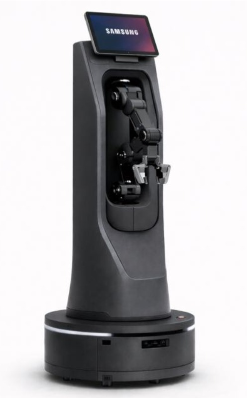

# **RAF:** Robô Autônomo de Farmácia

Trabalho de Interação Humano-Robô (IHR) apresentado ao Centro Universitário [FEI](https://portal.fei.edu.br/), como parte dos requisitos necessários para aprovação na disciplina de Interação Humano-Robô (IHR) (CCR230) do curso de Engenharia de Robôs, orientado pelo Prof. Dr. [Fagner de Assis Moura Pimentel](https://github.com/fagnerpimentel).

## Componentes do Grupo
 - Diego Gomes - 11.122.256-8
 - Miguel Savordelli - 11.122.007-5
 - Vinicius Grec - 11.122.375-6

## Resumo

O RAF (Robô Autônomo de Farmácia) é desenvolvido para automatizar a busca e o transporte de medicamentos em farmácias. Sua função é localizar os produtos nas prateleiras, retirá-los com uma garra e levá-los até o balcão de atendimento. Com isso, busca reduzir o tempo de espera dos clientes, facilitar o trabalho dos funcionários e tornar o atendimento mais rápido e eficiente.

## Introdução

Atualmente, as farmácias lidam diariamente com uma grande quantidade de medicamentos armazenados em prateleiras, o que exige que os funcionários realizem constantemente tarefas de localização, separação e transporte dos produtos até o balcão de atendimento. Esse processo pode gerar filas, aumentar o tempo de espera dos clientes e sobrecarregar os funcionários, principalmente em horários de maior movimento. Nesse contexto, a automação dessas atividades torna-se uma alternativa importante para melhorar a eficiência e a agilidade dos estabelecimentos.

O RAF é um robô desenvolvido para auxiliar no atendimento farmacêutico, tendo como principal função localizar e retirar medicamentos das prateleiras e transportá-los até o balcão de atendimento. Por meio de sensores e mecanismos de manipulação, o robô deverá identificar os produtos solicitados e realizar sua entrega de maneira autônoma e precisa.

O objetivo é automatizar a separação e o transporte de medicamentos das prateleiras até o balcão, reduzindo o tempo de atendimento e o esforço dos funcionários.

O RAF deve proporcionar uma experiência rápida, segura e intuitiva, transmitindo confiança aos funcionários e clientes, além de tornar o processo de atendimento mais eficiente e organizado.

## Público-Alvo e Stakeholders
### Público-Alvo
O público-alvo do RAF são farmácias, drogarias e estabelecimentos que trabalham com armazenamento e comercialização de medicamentos, especialmente aqueles que possuem grande variedade de produtos e alto fluxo de atendimento. O robô também será utilizado indiretamente por farmacêuticos e atendentes, auxiliando na separação e no transporte dos medicamentos até o balcão, além de beneficiar os clientes com um atendimento mais ágil.

### Stakeholders
Primários — farmacêuticos e atendentes da farmácia, que interagem diretamente com o RAF, solicitando a busca e a entrega dos medicamentos no balcão.

Secundários — clientes e demais funcionários da farmácia, que possuem contato indireto com o robô e são beneficiados pela redução do tempo de espera e pela agilidade no atendimento.

Terciários — proprietários e gerentes das farmácias, responsáveis pela implementação e manutenção do sistema, além de fornecedores de medicamentos e profissionais responsáveis pela organização do estoque, que podem ser impactados pelas mudanças nos processos internos.

### Personas

Persona primária — João, 24 anos: atendente de farmácia, responsável por auxiliar os clientes e separar os medicamentos solicitados pelos farmacêuticos. Trabalha em horários de grande movimento e frequentemente precisa percorrer diferentes prateleiras para encontrar os produtos. Possui familiaridade com tecnologias, mas não necessariamente conhecimentos técnicos sobre robótica. Espera que o RAF seja simples de operar, rápido e confiável. Antes de iniciar a tarefa, o robô deve receber o nome ou código do medicamento e o local de entrega.

Persona secundária — Maria, 58 anos
Cliente frequente de uma farmácia, que costuma comprar medicamentos e busca um atendimento rápido e organizado. Não possui muita familiaridade com tecnologias automatizadas e prefere interações simples e intuitivas. Espera que o RAF não atrapalhe a circulação da farmácia e que os medicamentos solicitados sejam entregues corretamente ao atendente. Valoriza a agilidade no atendimento, a segurança e a facilidade para encontrar os produtos desejados.

### Mapa de empatia
 
Persona: João, 24 anos, atendente de farmácia.

O que ele PENSA E SENTE?
 - Deseja atender os clientes com rapidez.
 - Preocupa-se em separar os medicamentos corretamente.
 - Sente pressão em horários de grande movimento.

O que ele ESCUTA?
 - Clientes reclamando da demora.
 - Farmacêuticos solicitando medicamentos.
 - Gerentes cobrando produtividade.

O que ele VÊ?
 - Prateleiras com muitos medicamentos.
 - Clientes aguardando atendimento.
 - Funcionários procurando produtos constantemente.

O que ele FALA E FAZ?
 - Procura medicamentos nas prateleiras.
 - Confere os produtos antes da entrega.
 - Busca agilizar o atendimento.

DORES
 - Demora para localizar medicamentos.
 - Sobrecarga de tarefas.
 - Cansaço pela movimentação constante.

GANHOS
 - Agilidade na separação dos medicamentos.
 - Redução do esforço físico.
 - Mais tempo para atender os clientes.

Mapa de empatia — Maria, 58 anos

O que pensa e sente?
- Deseja ser atendida rapidamente e sem complicações.
- Preocupa-se em receber o medicamento correto.
- Sente certa insegurança ao utilizar tecnologias com as quais não está familiarizada.

O que vê?
- Funcionários procurando medicamentos nas prateleiras.
- Clientes aguardando atendimento.
- O RAF circulando pela farmácia para transportar medicamentos.

O que ouve?
- Funcionários conversando e orientando os clientes.
- Reclamações sobre demora no atendimento.
- Explicações dos funcionários sobre o funcionamento do robô.

O que fala e faz?
- Solicita ajuda aos funcionários para encontrar medicamentos.
- Pergunta sobre o tempo de espera.
- Prefere ser atendida por pessoas quando não entende alguma tecnologia.

Dores (dificuldades):
- Longo tempo de espera.
- Dificuldade para encontrar determinados medicamentos.
- Receio de que o robô atrapalhe a circulação ou entregue um produto incorreto.

Ganhos (necessidades):
- Atendimento mais rápido e organizado.
- Receber o medicamento correto.
- Ter uma experiência simples, segura e sem complicações.

## Contexto de uso

O RAF será utilizado no ambiente interno de farmácias e drogarias, circulando entre as prateleiras de armazenamento de medicamentos e o balcão de atendimento. O ambiente apresenta movimentação constante de funcionários e clientes, especialmente em horários de pico, exigindo que o robô se desloque com segurança, evitando obstáculos e pessoas. O sistema deve atender estabelecimentos de diferentes portes, contribuindo para agilizar o atendimento e reduzir tarefas repetitivas.

Antes de iniciar uma tarefa, o robô precisa conhecer a organização das prateleiras, a localização dos medicamentos, a posição do balcão, os corredores disponíveis para circulação e a disponibilidade dos produtos em estoque.

## Jornada do usuário

Narrativa: João, atendente de uma farmácia, recebe uma solicitação de medicamento feita por Maria. Em vez de precisar procurar o produto manualmente nas prateleiras, utiliza o RAF para realizar a tarefa. Durante o processo, Maria continua seu atendimento e pode observar a movimentação do robô, beneficiando-se de um serviço mais ágil e organizado.

1. Solicitação: João informa ao RAF o nome ou código do medicamento solicitado, por comando de voz ou pela tela (verbal).

2. Confirmação: o robô confirma o medicamento e verifica sua localização no estoque, evitando possíveis erros (verbal).

3. Deslocamento: o RAF se desloca até a prateleira correspondente, desviando de pessoas e obstáculos. Ao encontrar Maria ou outros clientes, mantém uma distância segura e evita interromper a circulação (espacial).

4. Retirada: ao chegar ao local, identifica o medicamento e utiliza sua garra para retirá-lo da prateleira (não-verbal).

5. Transporte: o robô leva o produto até o balcão, evitando atrapalhar a circulação de funcionários e clientes (espacial).

6. Sinalização da entrega: ao chegar ao destino, informa que a entrega foi concluída e apresenta uma expressão de satisfação na tela, aguardando a retirada do medicamento por João (verbal + não-verbal).

7. Finalização: João retira o medicamento e confirma o recebimento. Maria é beneficiada pela maior agilidade do atendimento, sem precisar interagir diretamente com o robô.

## Análise de concorrência

Atualmente, existem robôs que automatizam o armazenamento, a localização e a separação de medicamentos em farmácias e hospitais. Alguns exemplos são:
1. BD Rowa Vmax
- Pontos positivos: automatiza o armazenamento e a retirada de medicamentos, possui alta capacidade de armazenamento e agiliza a dispensação.
- Pontos negativos: exige instalação específica, possui custo elevado e depende de uma estrutura adaptada à farmácia. 
  BD+1
2. Swisslog PillPick / BoxPicker
- Pontos positivos: automatiza o armazenamento, a organização e a separação de medicamentos, contribuindo para reduzir erros operacionais.
- Pontos negativos: possui estrutura complexa e é voltado principalmente para hospitais e grandes centros de distribuição. 
  PubMed Central (PMC)+1
3. Omnicell XR2
- Pontos positivos: utiliza robótica e leitura de códigos de barras para identificar medicamentos, automatizar a separação e melhorar o controle do estoque.
- Pontos negativos: possui aplicação voltada principalmente para farmácias hospitalares e depende de integração com sistemas de gerenciamento. 
  Omnicell+1

## Design do Robô

### Forma, função e affordances

O RAF possui uma estrutura vertical com uma base móvel circular, uma tela na parte superior e um braço robótico com uma garra na região frontal. A tela permite que os funcionários interajam com o robô por meio de comandos, enquanto o braço e a garra indicam sua capacidade de pegar e transportar medicamentos. A base circular permite a movimentação entre as prateleiras e o balcão. Para garantir a acessibilidade, a tela deve apresentar informações claras e de fácil utilização. Para "prometer menos e entregar mais", o RAF será apresentado como um robô auxiliar para transporte de medicamentos, sem criar a expectativa de que possa realizar atividades farmacêuticas complexas.

### Grau de antropomorfismo

O RAF apresenta características predominantemente minimalistas, estando mais próximo do polo máquina no espectro de antropomorfismo. Sua aparência não busca imitar um ser humano, mas apresenta elementos que facilitam a interação, como a tela e o braço robótico. Essa escolha combina com sua função, pois o objetivo principal é realizar tarefas de transporte e manipulação de medicamentos. O risco do vale da estranheza é baixo, já que o robô não possui aparência humana detalhada, expressões faciais ou movimentos que tentem imitar pessoas.

### Padrões de design

"Solicitação e confirmação" (o funcionário informa qual medicamento deseja e o robô confirma o pedido antes de iniciar a tarefa) + "buscar e entregar" (o robô se desloca até a prateleira, retira o medicamento e transporta até o balcão).

Esses dois padrões se combinam para formar o fluxo principal de funcionamento do RAF, garantindo que o medicamento correto seja identificado, coletado e entregue ao funcionário.

### Valores e ética

Valores: segurança (o robô deve transportar os medicamentos corretamente, evitando quedas, colisões e entregas equivocadas) e eficiência (deve reduzir o tempo gasto pelos funcionários na busca e no transporte dos produtos).

Risco ético: o RAF pode retirar ou entregar um medicamento incorreto, causando problemas no atendimento ao cliente.

Mitigação: implementar a identificação dos medicamentos por códigos de barras ou outros sistemas de reconhecimento, além de realizar uma confirmação do produto antes de efetuar a entrega no balcão.

### Protótipo no papel

O RAF será composto por uma base circular com rodas omnidirecionais, permitindo sua movimentação entre as prateleiras e o balcão. Seu corpo terá formato vertical e retangular, com uma estrutura frontal que abriga um braço robótico articulado e uma garra para retirar e transportar medicamentos. Na parte superior, haverá uma tela para receber comandos e apresentar informações ao usuário. O braço deverá possuir articulações para alcançar diferentes posições nas prateleiras.

Dimensões aproximadas:
- Altura total: 1,50 m.
- Diâmetro da base: 0,60 m.
- Tela posicionada na parte superior.
- Braço articulado com garra na região frontal.
- Sensores na base para identificar obstáculos e auxiliar na navegação.
O protótipo terá aparência predominantemente mecânica e minimalista, priorizando a funcionalidade, a segurança e a facilidade de interação com os funcionários.

 

## Ações do robô

Buscar medicamento — pré-requisito: o funcionário informa o nome ou código do medicamento, e o produto está cadastrado no sistema com localização conhecida. Ao finalizar: o medicamento é retirado da prateleira e fica na garra do robô.

Transportar medicamento — pré-requisito: o medicamento foi identificado e retirado corretamente. Ao finalizar: o produto é transportado até o balcão de atendimento.

Entregar medicamento — pré-requisito: o robô chegou ao balcão e identificou a posição de entrega. Ao finalizar: o medicamento fica disponível para retirada pelo funcionário.

Retornar à posição inicial — pré-requisito: a entrega foi concluída e o braço robótico está recolhido. Ao finalizar: o RAF retorna à posição de espera, ficando disponível para uma nova solicitação.

## Interações do robô

### Espacial

Interação espacial
Posicionamento: o RAF mantém uma distância segura dos funcionários e clientes, evitando invadir o espaço pessoal. Ao interagir diretamente com um funcionário, posiciona-se de frente para o balcão, mantendo a tela orientada para ele. Essa organização permite uma interação na zona social da proxêmica e considera as F-formations, posicionando o robô de maneira que não atrapalhe o espaço de interação entre as pessoas.

Início da movimentação: desloca-se pelos corredores em velocidade reduzida, evitando pessoas, prateleiras e outros obstáculos. Ao se aproximar de um funcionário, deve fazê-lo pela frente ou por um ângulo lateral, evitando aproximações inesperadas por trás.

Sinalização de destino: orienta seu corpo e braço robótico na direção da prateleira antes de iniciar a retirada do medicamento. Durante o deslocamento, pode utilizar sinais luminosos ou sonoros para indicar que está em movimento e alertar as pessoas próximas.

Grupos e corredores: ao encontrar pessoas conversando, reduz a velocidade e aguarda uma passagem livre ou realiza um desvio, sem passar entre elas. Ao encontrar pessoas paradas, também deve reduzir a velocidade e desviar quando houver espaço seguro.

Ajuste de contexto: em farmácias com corredores estreitos, o RAF reduz sua velocidade e prioriza aguardar a passagem de funcionários e clientes, evitando manobras que possam comprometer a segurança.

### Verbal

Restrita — utiliza comandos pré-programados para receber solicitações, confirmar medicamentos e informar o andamento das tarefas. Essa escolha torna a comunicação mais simples e reduz erros durante a operação.

Solicitação: o funcionário informa o medicamento desejado pela tela ou por comando de voz.

Confirmação: o RAF informa qual medicamento foi solicitado antes de iniciar a busca.

Entrega: ao chegar ao balcão, avisa que o medicamento está disponível para retirada.

Timing: o robô apresenta pequenos sinais sonoros enquanto processa os comandos, evitando que o funcionário pense que o sistema parou de funcionar.

Voz: utiliza uma voz neutra, clara e objetiva, com volume ajustável de acordo com o ambiente da farmácia.

Limitação do reconhecimento de fala: ruídos e conversas simultâneas podem dificultar a identificação dos nomes dos medicamentos. Como solução, o RAF também permite selecionar os produtos por meio da tela ou leitura de códigos de barras.

### Não-verbal
Canais não verbais:
- Postura e gestos: o RAF movimenta seu braço robótico em direção à prateleira para indicar que está iniciando a retirada do medicamento. Ao finalizar a tarefa, recolhe o braço e retorna à posição de espera.
- Sinais luminosos: utiliza luzes na base para indicar seu estado de funcionamento: aguardando uma solicitação, realizando uma tarefa ou concluindo uma entrega.
- Percepção: o RAF utiliza câmeras e sensores de proximidade para identificar a posição e a movimentação de funcionários e clientes. Assim, consegue reconhecer quando alguém está circulando, parado próximo às prateleiras ou bloqueando sua passagem, ajustando seu deslocamento para evitar colisões e não atrapalhar o atendimento.

- Falta de coordenação: caso o RAF informe verbalmente que o medicamento está disponível, mas ainda esteja movimentando seu braço robótico para finalizar a retirada, o funcionário poderá tentar pegar o produto antes da hora, causando confusão ou comprometendo a segurança.

- Pista não verbal exclusiva: um anel luminoso na base do RAF muda de cor conforme o andamento da tarefa, permitindo que funcionários e clientes identifiquem seu estado mesmo sem ouvir as mensagens sonoras.

## Emoção

Modelo: modelo das emoções básicas de Ekman, utilizando principalmente felicidade e neutralidade. A escolha se justifica pela presença de um rosto no tablet do RAF, permitindo representar visualmente diferentes estados emocionais.

Percepção: o robô identifica possíveis sinais de satisfação ou frustração por meio do tom de voz e das interações com o funcionário.

Mimetismo: quando o funcionário demonstra satisfação e quando finaliza uma tarefa, o RAF apresenta uma expressão feliz na tela. Caso perceba frustração, apresenta uma expressão neutra e mantém uma comunicação calma, evitando imitar emoções negativas.

Risco de expectativa: por possuir um rosto com expressões, os funcionários podem esperar que o robô tenha capacidades de interação semelhantes às humanas. Para evitar isso, suas expressões serão simples e limitadas às situações relacionadas ao funcionamento do robô.

---                                                                                                                                                                                                                                                                                                                                                                                                                                                                                                                                                                                                                                                                                                                                     
[^1]: Fonte: Adaptado de <https://hazeshift.com.br/mapa-de-empatia/>
