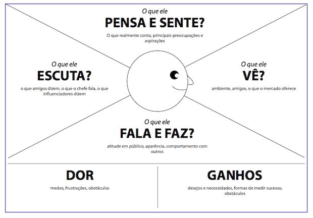

# **RAF:** Robô Autônomo de Farmácia

Trabalho de Interação Humano-Robô (IHR) apresentado ao Centro Universitário [FEI](https://portal.fei.edu.br/), como parte dos requisitos necessários para aprovação na disciplina de Interação Humano-Robô (IHR) (CCR230) do curso de Engenharia de Robôs, orientado pelo Prof. Dr. [Fagner de Assis Moura Pimentel](https://github.com/fagnerpimentel).

## Componentes do Grupo
 - Diego Gomes - 11.122.256-8
 - Miguel Savordelli - 11.122.007-5
 - Vinicius Grec - 11.122.375-6

## Resumo

O robô farmacêutico é um sistema robótico desenvolvido para automatizar o processo de separação e entrega de medicamentos em farmácias. Sua principal função é localizar e retirar os remédios armazenados em prateleiras, transportando-os até um balcão de atendimento, onde ficam disponíveis para serem entregues ao cliente ou ao funcionário responsável.

O robô pode utilizar sensores e sistemas de visão computacional para identificar os medicamentos, localizar suas posições nas prateleiras e realizar a movimentação com precisão. Além disso, pode contar com mecanismos de manipulação, como garras, para pegar e transportar os produtos com segurança.

A implementação desse sistema tem como objetivo reduzir o tempo de atendimento, diminuir erros na separação de medicamentos, otimizar a organização dos produtos e reduzir o esforço dos funcionários em tarefas repetitivas. Dessa forma, o robô atua como um auxiliar no ambiente farmacêutico, tornando o processo de atendimento mais ágil, eficiente e organizado.

## Introdução

Atualmente, as farmácias lidam diariamente com uma grande quantidade de medicamentos armazenados em prateleiras, o que exige que os funcionários realizem constantemente tarefas de localização, separação e transporte dos produtos até o balcão de atendimento. Esse processo pode gerar filas, aumentar o tempo de espera dos clientes e sobrecarregar os funcionários, principalmente em horários de maior movimento. Nesse contexto, a automação dessas atividades torna-se uma alternativa importante para melhorar a eficiência e a agilidade dos estabelecimentos.

O RAF é um robô desenvolvido para auxiliar no atendimento farmacêutico, tendo como principal função localizar e retirar medicamentos das prateleiras e transportá-los até o balcão de atendimento. Por meio de sensores e mecanismos de manipulação, o robô deverá identificar os produtos solicitados e realizar sua entrega de maneira autônoma e precisa.

Objetivo: automatizar a separação e o transporte de medicamentos das prateleiras até o balcão, reduzindo o tempo de atendimento e o esforço dos funcionários.

Experiência desejada: proporcionar uma experiência rápida, segura e intuitiva, transmitindo confiança aos funcionários e clientes, além de tornar o processo de atendimento mais eficiente e organizado.

## Público-Alvo e Stakeholders
### Público-Alvo
O público-alvo do RAF (Robô Autônomo de Farmácia) são farmácias, drogarias e estabelecimentos que trabalham com armazenamento e comercialização de medicamentos, especialmente aqueles que possuem grande variedade de produtos e alto fluxo de atendimento. O robô também será utilizado indiretamente por farmacêuticos e atendentes, auxiliando na separação e no transporte dos medicamentos até o balcão, além de beneficiar os clientes com um atendimento mais ágil.

### Stakeholders
Primários — farmacêuticos e atendentes da farmácia, que interagem diretamente com o RAF, solicitando a busca e a entrega dos medicamentos no balcão.

Secundários — clientes e demais funcionários da farmácia, que possuem contato indireto com o robô e são beneficiados pela redução do tempo de espera e pela agilidade no atendimento.

Terciários — proprietários e gerentes das farmácias, responsáveis pela implementação e manutenção do sistema, além de fornecedores de medicamentos e profissionais responsáveis pela organização do estoque, que podem ser impactados pelas mudanças nos processos internos.

### Personas
Persona primária — Mariana, 32 anos: farmacêutica responsável por uma drogaria de médio porte, com grande variedade de medicamentos e fluxo constante de clientes. Precisa localizar e separar diversos medicamentos ao longo do dia, conciliando o atendimento ao público com outras responsabilidades. Busca agilidade, precisão e redução de tarefas repetitivas. Antes de iniciar uma tarefa, o RAF deve saber qual medicamento foi solicitado, sua localização no estoque e a quantidade necessária.

Persona secundária — João, 24 anos: atendente de farmácia, responsável por auxiliar os clientes e separar os medicamentos solicitados pelos farmacêuticos. Trabalha em horários de grande movimento e frequentemente precisa percorrer diferentes prateleiras para encontrar os produtos. Possui familiaridade com tecnologias, mas não necessariamente conhecimentos técnicos sobre robótica. Espera que o RAF seja simples de operar, rápido e confiável. Antes de iniciar a tarefa, o robô deve receber o nome ou código do medicamento e o local de entrega.

### Mapa de empatia

Persona: Mariana, 32 anos, farmacêutica responsável por uma drogaria.

O que ela PENSA E SENTE?
 - Deseja garantir um atendimento rápido e eficiente.
 - Preocupa-se com a precisão na separação dos medicamentos.
 - Busca melhorar a produtividade da farmácia.
  
O que ela ESCUTA?
 - Clientes reclamando da demora.
 - Funcionários relatando dificuldades na rotina.
 - Gerentes cobrando qualidade no atendimento.
  
O que ela VÊ?
 - Grande variedade de medicamentos nas prateleiras.
 - Funcionários ocupados procurando produtos.
 - Filas em horários de maior movimento.
  
O que ela FALA E FAZ?
 - Orienta os atendentes na separação dos medicamentos.
 - Confere prescrições e produtos.
 - Supervisiona o funcionamento da farmácia.
  
DORES
 - Demora na localização dos medicamentos.
 - Sobrecarga dos funcionários.
 - Risco de erros na separação dos produtos.
  
GANHOS
 - Maior agilidade no atendimento.
 - Redução de erros operacionais.
 - Melhor aproveitamento do tempo dos funcionários.
  
Persona: João, 24 anos, atendente de farmácia.

O que ele PENSA E SENTE?
 - Deseja atender os clientes com rapidez.
 - Preocupa-se em separar os medicamentos corretamente.
 - Sente pressão em horários de grande movimento.

O que ele ESCUTA?
 - Clientes reclamando da demora.
 - Farmacêuticos solicitando medicamentos.
 - Gerentes cobrando produtividade.

O que ele VÊ?
 - Prateleiras com muitos medicamentos.
 - Clientes aguardando atendimento.
 - Funcionários procurando produtos constantemente.

O que ele FALA E FAZ?
 - Procura medicamentos nas prateleiras.
 - Confere os produtos antes da entrega.
 - Busca agilizar o atendimento.

DORES
 - Demora para localizar medicamentos.
 - Sobrecarga de tarefas.
 - Cansaço pela movimentação constante.

GANHOS
 - Agilidade na separação dos medicamentos.
 - Redução do esforço físico.
 - Mais tempo para atender os clientes.

## Contexto de uso

O RAF será utilizado no ambiente interno de farmácias e drogarias, circulando entre as prateleiras de armazenamento de medicamentos e o balcão de atendimento. O ambiente apresenta movimentação constante de funcionários e clientes, especialmente em horários de pico, exigindo que o robô se desloque com segurança, evitando obstáculos e pessoas. O sistema deve atender estabelecimentos de diferentes portes, contribuindo para agilizar o atendimento e reduzir tarefas repetitivas.

Antes de iniciar uma tarefa, o robô precisa conhecer a organização das prateleiras, a localização dos medicamentos, a posição do balcão, os corredores disponíveis para circulação e a disponibilidade dos produtos em estoque.

## Jornada do usuário

Narrativa: João, atendente de uma farmácia, recebe uma solicitação de medicamento feita por um farmacêutico. Em vez de precisar procurar o produto manualmente nas prateleiras, ele utiliza o RAF para realizar a tarefa.
1. João informa ao RAF o nome ou código do medicamento solicitado (verbal ou tela).
2. O robô confirma o medicamento e verifica sua localização no estoque (verbal).
3. O RAF se desloca até a prateleira correspondente, desviando de pessoas e obstáculos (espacial).
4. Ao chegar ao local, identifica o medicamento e utiliza sua garra para retirá-lo da prateleira (não-verbal).
5. O robô transporta o produto até o balcão, evitando atrapalhar a circulação de funcionários e clientes (espacial).
6. Ao chegar ao destino, sinaliza que a entrega foi concluída e aguarda a retirada do medicamento pelo funcionário (verbal + não-verbal).
7. João retira o medicamento e confirma o recebimento, encerrando a tarefa.
Durante todo o processo, a farmácia continua funcionando normalmente, com clientes e funcionários circulando pelo ambiente. O RAF deve realizar seus movimentos com segurança, sem bloquear corredores ou interferir no atendimento.

## Análise de concorrência

Atualmente, existem robôs que automatizam o armazenamento, a localização e a separação de medicamentos em farmácias e hospitais. Alguns exemplos são:
1. BD Rowa Vmax
- Pontos positivos: automatiza o armazenamento e a retirada de medicamentos, possui alta capacidade de armazenamento e agiliza a dispensação.
- Pontos negativos: exige instalação específica, possui custo elevado e depende de uma estrutura adaptada à farmácia. 
  BD+1
2. Swisslog PillPick / BoxPicker
- Pontos positivos: automatiza o armazenamento, a organização e a separação de medicamentos, contribuindo para reduzir erros operacionais.
- Pontos negativos: possui estrutura complexa e é voltado principalmente para hospitais e grandes centros de distribuição. 
  PubMed Central (PMC)+1
3. Omnicell XR2
- Pontos positivos: utiliza robótica e leitura de códigos de barras para identificar medicamentos, automatizar a separação e melhorar o controle do estoque.
- Pontos negativos: possui aplicação voltada principalmente para farmácias hospitalares e depende de integração com sistemas de gerenciamento. 
  Omnicell+1

## Design do Robô

### Forma, função e affordances

O RAF possui uma estrutura vertical com uma base móvel circular, uma tela na parte superior e um braço robótico com uma garra na região frontal. A tela permite que os funcionários interajam com o robô por meio de comandos, enquanto o braço e a garra indicam sua capacidade de pegar e transportar medicamentos. A base circular permite a movimentação entre as prateleiras e o balcão. Para garantir a acessibilidade, a tela deve apresentar informações claras e de fácil utilização. Para "prometer menos e entregar mais", o RAF será apresentado como um robô auxiliar para transporte de medicamentos, sem criar a expectativa de que possa realizar atividades farmacêuticas complexas.

### Grau de antropomorfismo

O RAF apresenta características predominantemente minimalistas, estando mais próximo do polo máquina no espectro de antropomorfismo. Sua aparência não busca imitar um ser humano, mas apresenta elementos que facilitam a interação, como a tela e o braço robótico. Essa escolha combina com sua função, pois o objetivo principal é realizar tarefas de transporte e manipulação de medicamentos. O risco do vale da estranheza é baixo, já que o robô não possui aparência humana detalhada, expressões faciais ou movimentos que tentem imitar pessoas.

### Padrões de design

"Solicitação e confirmação" (o funcionário informa qual medicamento deseja e o robô confirma o pedido antes de iniciar a tarefa) + "buscar e entregar" (o robô se desloca até a prateleira, retira o medicamento e transporta até o balcão).

Esses dois padrões se combinam para formar o fluxo principal de funcionamento do RAF, garantindo que o medicamento correto seja identificado, coletado e entregue ao funcionário.

### Valores e ética

Valores: segurança (o robô deve transportar os medicamentos corretamente, evitando quedas, colisões e entregas equivocadas) e eficiência (deve reduzir o tempo gasto pelos funcionários na busca e no transporte dos produtos).

Risco ético: o RAF pode retirar ou entregar um medicamento incorreto, causando problemas no atendimento ao cliente.

Mitigação: implementar a identificação dos medicamentos por códigos de barras ou outros sistemas de reconhecimento, além de realizar uma confirmação do produto antes de efetuar a entrega no balcão.

### Protótipo no papel

O RAF será composto por uma base circular com rodas omnidirecionais, permitindo sua movimentação entre as prateleiras e o balcão. Seu corpo terá formato vertical e retangular, com uma estrutura frontal que abriga um braço robótico articulado e uma garra para retirar e transportar medicamentos. Na parte superior, haverá uma tela para receber comandos e apresentar informações ao usuário. O braço deverá possuir articulações para alcançar diferentes posições nas prateleiras.

Dimensões aproximadas:
- Altura total: 1,50 m.
- Diâmetro da base: 0,60 m.
- Tela posicionada na parte superior.
- Braço articulado com garra na região frontal.
- Sensores na base para identificar obstáculos e auxiliar na navegação.
O protótipo terá aparência predominantemente mecânica e minimalista, priorizando a funcionalidade, a segurança e a facilidade de interação com os funcionários.

## Ações do robô

> 💡
> Para cada ação:
> - Descreva a ação.
> - Determine os pré-requisitos para que a ação aconteça
> - Determine o que se espera que seja modificado no ambiente quando a ação é finalizada

📄

**Guiar até o destino** — pré-requisito: destino escolhido no menu e caminho livre conhecido no mapa do dia. Ao finalizar: o visitante está fisicamente no laboratório e o robô retorna à posição de espera no saguão.

**Dar informação rápida** — pré-requisito: pergunta reconhecida dentro do conjunto de perguntas frequentes cadastradas. Ao finalizar: a resposta foi falada e também exibida na tela.

## Interações do robô

### Espacial

> 💡
> - Descreva **onde** o robô se posiciona em relação ao usuário (distância e orientação do corpo), usando as **zonas de proxêmica** (Hall) e as **F-formations**.
> - Como o robô **inicia** a interação (direção de aproximação) e como **sinaliza** para onde vai?
> - Para cada interação espacial:
>   - Descreva a interação.
>   - Determine os pré-requisitos para que a interação aconteça.
>   - Determine a resposta emocional esperada do usuário quando a interação é finalizada.
> - O que o robô faz ao encontrar pessoas **paradas, em conversa ou em grupo**, e ao passar por elas num corredor (sem cruzar entre pessoas conversando)?
> - Proponha **um ajuste** desse comportamento espacial para um contexto de uso diferente do principal.

📄

- **Posicionamento:** aborda o grupo a uma distância social (2–3 m), sempre pela frente, nunca por trás.
- **Início da aproximação:** aproxima-se em diagonal (nunca em linha reta "contra" a pessoa), reduzindo a velocidade a 1,5 m de distância.
- **Sinalização de destino:** gira a "cabeça" na direção do laboratório antes de começar a andar.
- **Grupos e corredores:** ao encontrar duas pessoas conversando, contorna por trás delas, sem passar entre as duas; para grupos maiores, aguarda uma abertura natural na formação.
- **Ajuste de contexto:** em dias normais de aula (sem evento), o robô aumenta a distância de abordagem, já que há menos ruído social e mais espaço livre no saguão.

### Verbal

> 💡
> - A interação verbal do robô será **restrita** (comandos, FSM) ou **aberta** (LLM/chatbot)? Justifique a escolha.
> - Para cada interação verbal:
>   - Descreva a interação.
>   - Determine os pré-requisitos para que a interação aconteça.
>   - Determine a resposta emocional esperada do usuário quando a interação é finalizada.
> - Como o robô lida com o **timing** das respostas (silêncio, marcadores conversacionais como "uh-huh")?
> - Que tipo de voz (TTS) o robô usa, e por que ela **combina** com a aparência e o propósito dele?
> - Identifique **uma limitação** do reconhecimento de fala (ruído, sotaque, vocabulário) que afetaria o seu cenário de uso, e como mitigá-la.

📄

**Restrita** — usa uma árvore de diálogo (FSM) com um conjunto fechado de destinos e perguntas frequentes, pois o saguão é ruidoso e o vocabulário esperado é previsível; mais confiável do que abrir para um LLM.

**Timing:** ao processar um pedido, o robô emite um "hum" sonoro curto e pisca os olhos em sequência, evitando silêncio constrangedor.

**Voz:** TTS de tom jovem e neutro, volume ajustável ao ruído do saguão — combina com o porte pequeno do robô (uma voz grave soaria estranha).

**Limitação do ASR:** o ruído do evento atrapalha o reconhecimento de nomes de professores e disciplinas. **Mitigação:** escolhas críticas (curso, laboratório) são feitas por toque na tela; o reconhecimento de fala só é usado para perguntas simples de sim/não.

### Não-verbal

> 💡
> - Escolha **dois canais** não verbais (olhar, gesto, toque, postura, ritmo, imitação) e descreva como o robô os usaria.
> - Para cada interação não-verbal:
>   - Descreva a interação.
>   - Determine os pré-requisitos para que a interação aconteça.
>   - Determine a resposta emocional esperada do usuário quando a interação é finalizada.
> - Explique como o robô **perceberia** as pistas não verbais correspondentes da pessoa.
> - Descreva um caso em que a **falta de coordenação** entre fala e comportamento não verbal quebraria a interação.
> - Proponha **uma pista não verbal exclusiva** do robô (sem equivalente humano direto) que ajudaria na comunicação.

📄

**Canais escolhidos: olhar e postura.**
- **Olhar:** os "olhos" de LED giram na direção de quem está falando com o robô e na direção da rota a seguir.
- **Postura:** o corpo se inclina levemente para frente ao iniciar a aproximação (convite) e se afasta/gira de lado ao encerrar a interação (despedida).

**Percepção:** uma câmera de profundidade detecta se a pessoa está olhando para o robô (atenção) e se está parada olhando ao redor (sinal de estar perdida).

**Falta de coordenação:** se o robô disser "vamos ao laboratório de robótica" mas girar para o lado errado, o grupo hesita e para de segui-lo — a confiança se quebra.

**Pista exclusiva do robô:** um anel de luz na base pisca em verde quando o robô está confiante do caminho e em amarelo quando está recalculando a rota — sem equivalente humano direto, mas comunica incerteza de forma clara.

## Emoção

> 💡
> - Escolha um **modelo de emoção** (categorias básicas de Ekman, modelo OCC ou modelo dimensional — Russell ou PAD) e justifique a escolha para o seu caso de uso.
> - Descreva **como** o robô perceberia o estado emocional do usuário, e por quais canais (rosto, voz, postura, outro).
> - Defina **quando** o robô deve mimetizar a emoção da pessoa e **quando não deve** (lembre-se da exceção da raiva — retribuir raiva raramente ajuda a resolver o conflito).
> - Identifique um risco de **gerenciamento de expectativas**: se o robô parece emocionalmente responsivo, que outras capacidades sociais o usuário passa a esperar dele? O robô consegue cumprir essa expectativa?

📄

**Modelo:** categorias básicas de Ekman (feliz, surpreso, neutro) — simples o suficiente para expressar por luzes e tom de voz, sem exigir um rosto detalhado.

**Percepção:** o robô reconhece tom de voz alterado (frustração) pelo microfone e expressões faciais básicas pela câmera, para saber se o visitante está confuso ou satisfeito.

**Mimetismo:** mimetiza entusiasmo — se o visitante se anima ao ver o laboratório de robótica, o robô "sorri" com as luzes — mas **nunca** mimetiza a impaciência de um visitante apressado; nesse caso mantém tom calmo e oferece um caminho mais curto.

**Risco de expectativa:** se o robô demonstra "empolgação", visitantes podem esperar que ele converse sobre assuntos abertos (ex.: "e as notas de corte?"). O robô precisa deixar claro, de forma simpática, quando um assunto está fora do seu escopo.

---                                                                                                                                                                                                                                                                                                                                                                                                                                                                                                                                                                                                                                                                                                                                     
[^1]: Fonte: Adaptado de <https://hazeshift.com.br/mapa-de-empatia/>
